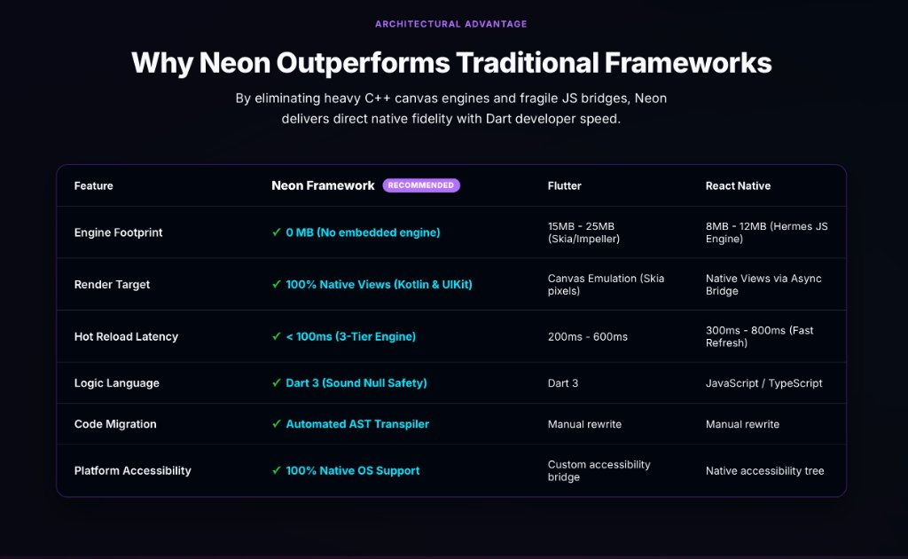
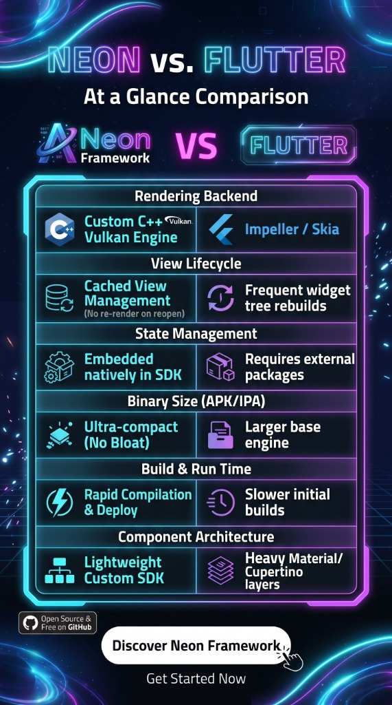
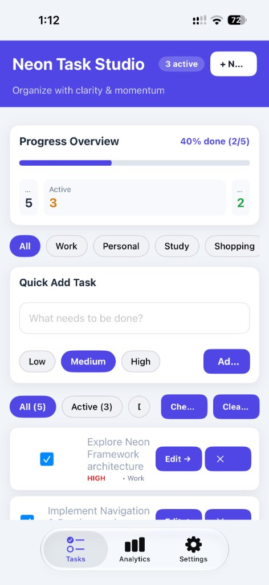
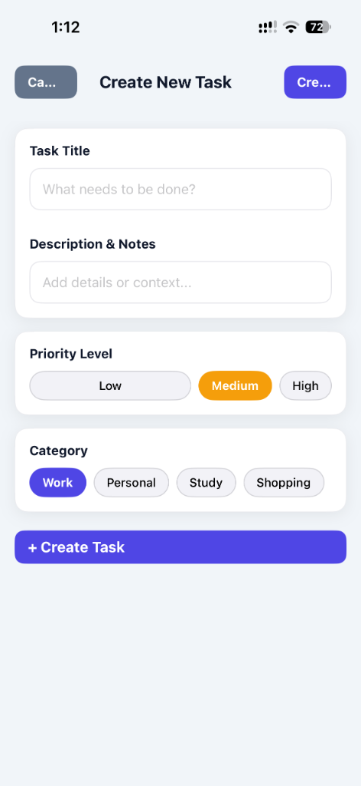
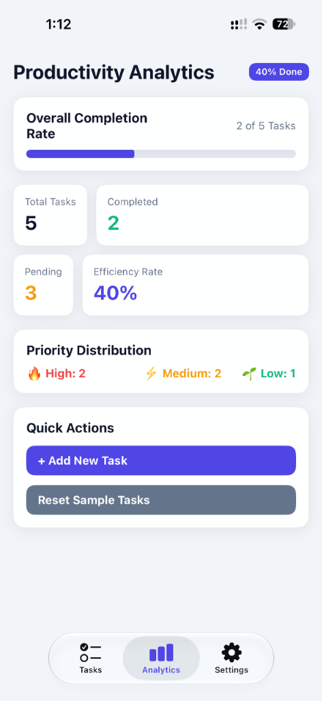
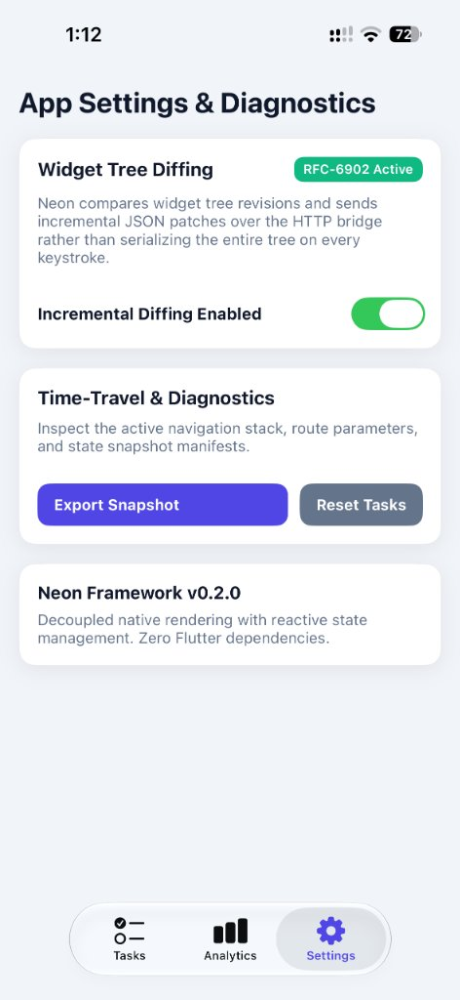

# neon_framework ⚡

> **A standalone, Flutter-free Dart SDK for building true native mobile applications on Android & iOS.**

<p align="center">
  
</p>

<p align="center">
  <a href="https://neonframework.dev"></a>
  <a href="https://docs.neonframework.dev/docs/quick-start"></a>
  <a href="https://dart.dev"></a>
  <a href="https://developer.android.com"></a>
  
  <a href="LICENSE"></a>
</p>

<p align="center">
  🌐 <a href="https://neonframework.dev"><strong>neonframework.dev</strong></a> &nbsp;&bull;&nbsp; 
  📚 <a href="https://docs.neonframework.dev/docs/quick-start"><strong>Official Documentation & Quick Start</strong></a>
</p>

---

## Architectural Advantage

<p align="center">
  
</p>

---

## Neon vs. Flutter Comparison

<p align="center">
  
</p>

---

## 📱 Featured Demo App: Neon Task Studio

> **GitHub Repository**: [`https://github.com/hamze-ibraheem/neon_to_do_list_app.git`](https://github.com/hamze-ibraheem/neon_to_do_list_app.git)

A full-featured reference to-do and productivity application built with **Neon Framework v0.2.0**:

<p align="center">
  
  &nbsp;
  
  &nbsp;
  
  &nbsp;
  
</p>

- **Real-Time Diffing Diagnostics**: Live RFC-6902 tree diffing toggle on the settings screen.
- **Pure Dart State**: Reactive signals managing tasks, priorities, categories, and metrics.
- **100% Native Views**: Rendered directly via Kotlin and UIKit shells without Flutter canvas layers.

---

## What is `neon_framework`?

`neon_framework` is a complete mobile application development SDK written entirely in Dart. It empowers developers to build mobile apps using declarative widgets, reactive signals, and native components without requiring Flutter, Skia, or Impeller.

### Core Highlights

- **100% Native Views**: Widgets map directly to genuine native platform components (`android.widget.*` on Android, UIKit `UIView` on iOS).
- **HTTP UI Server & Bridge**: The Dart runtime runs an embedded HTTP server serving the widget tree over JSON (`/api/tree`) and handling actions (`/action`).
- **High-Speed Tree Diffing**: In-place native view property updates with up to **98% payload compression**, keeping focus, keyboard, and scroll state intact.
- **Modern Material 3 Suite**: 40+ widgets including `FilledButton`, `SegmentedButton`, `NeonTextField`, `NeonSearchBar`, `Switch`, `Slider`, `Card`, `Dialog`, `BottomSheet`, `ListView`, and slivers.
- **Signals State Management**: SolidJS-inspired reactive signals (`NeonSignal`, `NeonComputed`, `NeonEffect`) and `NeonAsyncValue`.
- **Declarative Navigation**: Full router with parameter matching, query params, route guards, and history management.
- **Built-in Offline Data Layer**: Type-safe Key-Value store, SQLite with versioned migrations, REST HTTP Client with interceptors, WebSocket with auto-reconnect, and 5 caching policies.
- **Extensible Plugin System**: Dual-mode (Dart and Native) plugins with semantic versioning and dependency validation.

---

## Installation

Add `neon_framework` to your `pubspec.yaml`:

```yaml
dependencies:
  neon_framework:
    path: path/to/neon_framework # or git URL
```

Then run:
```bash
dart pub get
```

---

## Basic Usage

```dart
import 'package:neon_framework/neon.dart';

void main() {
  NeonApp.run(
    const MyCounterApp(),
    config: const NeonConfig(
      environment: NeonEnvironment.development,
      port: 8080,
      enableDiffing: true,
    ),
  );
}

class MyCounterApp extends StatefulWidget {
  const MyCounterApp({super.key});

  @override
  NeonState<MyCounterApp> createState() => _MyCounterAppState();
}

class _MyCounterAppState extends NeonState<MyCounterApp> {
  int _counter = 0;

  @override
  NeonWidget build(NeonBuildContext context) {
    return Container(
      padding: const NeonEdgeInsets.all(24),
      color: NeonColors.white,
      child: Column(
        mainAxisAlignment: MainAxisAlignment.center,
        crossAxisAlignment: CrossAxisAlignment.center,
        children: [
          Text(
            'Count: $_counter',
            style: const NeonTextStyle(fontSize: 22, color: NeonColors.indigo),
          ),
          const SizedBox(height: 16),
          FilledButton(
            key: 'btn_increment',
            onPressed: () {
              setState(() {
                _counter++;
              });
            },
            child: const Text('Increment'),
          ),
        ],
      ),
    );
  }
}
```

---

## Architectural Breakdown

```
neon_framework/
├── bin/
│   └── neon.dart                  # Neon developer CLI
├── lib/
│   ├── neon.dart                  # Public barrel export
│   └── src/
│       ├── core/                  # NeonApp, lifecycle, error handlers, config
│       ├── widgets/               # Widget system, Material 3 catalog, tree diff
│       ├── navigation/            # Router, path matcher, guards, controller
│       ├── rendering/             # Constraints, canvas, display lists, animation
│       ├── state/                 # Reactive signals, computed, effects, async values
│       ├── platform/              # Platform channels, bridge, filesystem
│       ├── data/                  # Key-value store, SQLite, HTTP, WebSocket, cache
│       ├── plugins/               # Plugin model, registry, semver, hooks
│       ├── language/              # NeonLang (.neon) Lexer, Parser, AST, Analyzer & Codegen
│       ├── packaging/             # Universal Cross-OS Builder (.apk, .bundle, .app, .ipa)
│       ├── lsp/                   # Language Server Protocol (neon-lsp)
│       ├── mcp/                   # Model Context Protocol Server (neon-mcp-server)
│       ├── agents/                # Google Antigravity SDK Multi-Agent Hub
│       └── ide/                   # Neon Studio IDE Workbench Engine
├── neon_studio/                   # Neon Studio IDE Server (:9090), Web UI, & Desktop Packager
├── examples/                      # Declarative .neon reference showcase screens
└── test/                          # 431 automated unit and integration tests
```

---

## State Management with Signals

In addition to traditional `setState()`, Neon provides reactive signals:

```dart
final count = NeonSignal<int>(0);
final doubleCount = NeonComputed<int>(() => count.value * 2);

NeonEffect(() {
  print('Current count: ${count.value}, doubled: ${doubleCount.value}');
});

count.value++;
```

---

## Declarative Routing

```dart
final router = NeonRouter(
  initialLocation: '/home',
  routes: [
    NeonRoute(
      path: '/home',
      builder: (context, state) => const HomeScreen(),
    ),
    NeonRoute(
      path: '/details/:id',
      builder: (context, state) => DetailScreen(id: state.param('id')),
    ),
  ],
);
```

---

## Subsystem Feature Options

Neon Framework provides typed feature options (`NeonFeatureOptions`) for fine-grained runtime control:

```dart
final config = NeonConfig(
  featureOptions: NeonFeatureOptions(
    diffing: const DiffingOptions(enabled: true, maxPatchBatchSize: 150),
    navigation: const NavigationOptions(enableTelemetry: true),
    diagnostics: const DiagnosticsOptions(verboseActionLogging: true),
  ),
);

// Toggle at runtime without rebooting the server:
NeonApp.instance.featureOptionsManager.mutate((opts) {
  return opts.copyWith(
    diffing: opts.diffing.copyWith(enabled: false),
  );
});
```

---

## Contributor PR Governance

Pull requests introducing new **features** or **enhancements** on `dev-beta-version-1.0.0` or `main` are restricted to authorized contributors. Community feature ideas should be proposed via an Issue/RFC first. See [`CONTRIBUTING.md`](../../CONTRIBUTING.md) for full instructions.

---

## Native Platform Integration

1. Start your Dart application with `dart run lib/main.dart`.
2. Connect your Android app (`MainActivity.kt`) using `adb reverse tcp:8080 tcp:8080`.
3. Connect your iOS app (`ViewController.swift`) pointing to `http://localhost:8080/api/tree`.
4. Open `http://localhost:8080` in your browser for the instant Web Preview.

---

## NeonLang (`.neon`), Neon Studio IDE & Cross-OS Packaging

- **Compile `.neon` to `.dart` (100% Two-Way Dart Interop):**
  ```bash
  dart run bin/neon.dart compile examples/task_studio.neon --watch
  ```
- **Launch Neon Studio IDE Workbench (`http://localhost:9090`):**
  ```bash
  dart run bin/neon.dart studio
  ```
- **Build Android (`.apk`, `.bundle`/`.aab`) & iOS (`.app`, `.ipa`) on Windows, macOS, or Linux Ubuntu:**
  ```bash
  dart run bin/neon.dart build -t apk
  dart run bin/neon.dart build -t bundle
  dart run bin/neon.dart build -t app
  dart run bin/neon.dart build -t ipa
  ```

---

## Testing

Run the full automated test suite:

```bash
dart test
```

All 431 tests pass cleanly with 0 analyzer warnings (`dart analyze --fatal-warnings`).

---

## ⚖️ Copyright & Ownership

**Neon Framework** is authored and owned by **Task Foundation LLC**, founded by **Hamza Ibrahim**.

- **Organization**: Task Foundation LLC
- **Founder**: Hamza Ibrahim
- **Website**: [https://taskfoundation.net](https://taskfoundation.net)
- **About Us**: [https://taskfoundation.net/about-us/](https://taskfoundation.net/about-us/)
- **Address**: 30 N Gould St, Ste R, Sheridan, WY 82801, United States
- **Contact**: [hamzaalsarsour@taskfoundation.net](mailto:hamzaalsarsour@taskfoundation.net)

---

## License

Copyright &copy; 2026 **Task Foundation LLC**. Founder: **Hamza Ibrahim**.

Distributed under the [MIT License](LICENSE).

