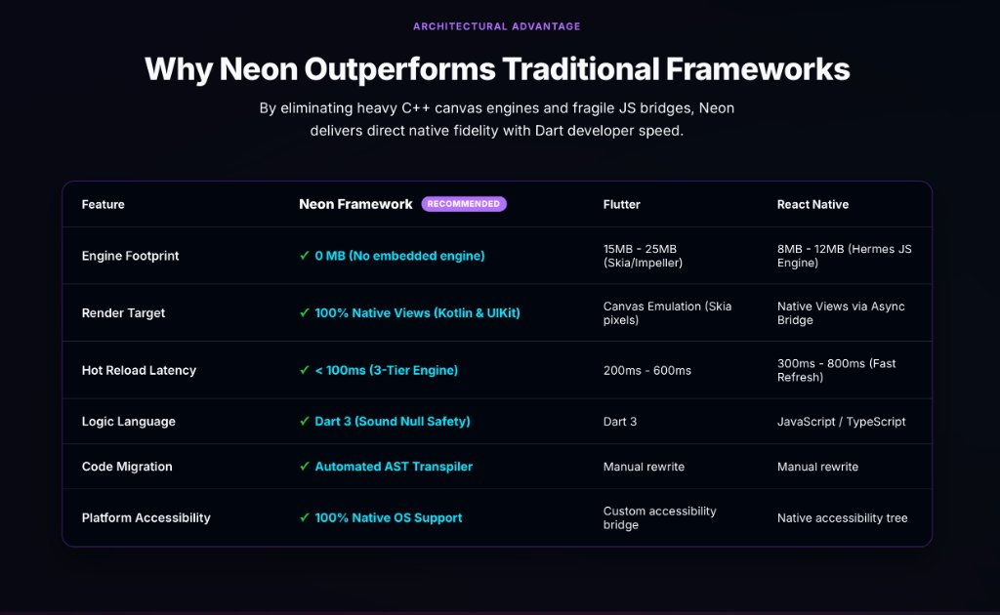
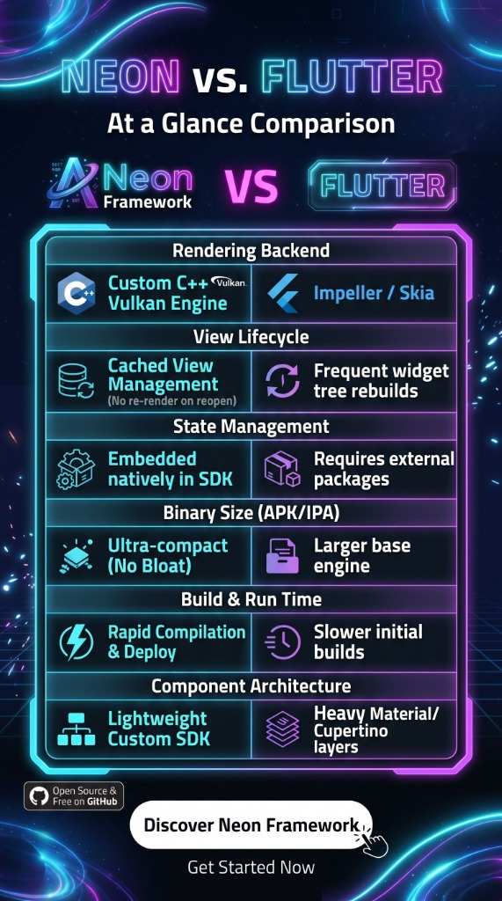
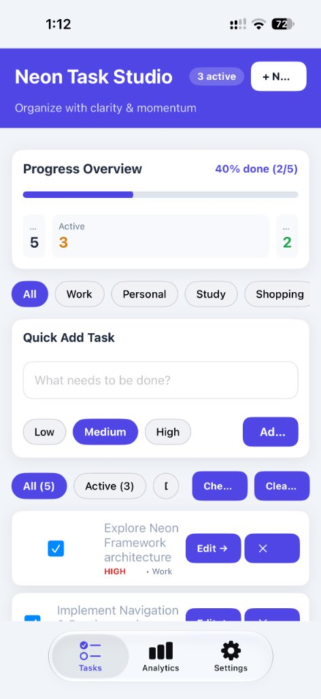
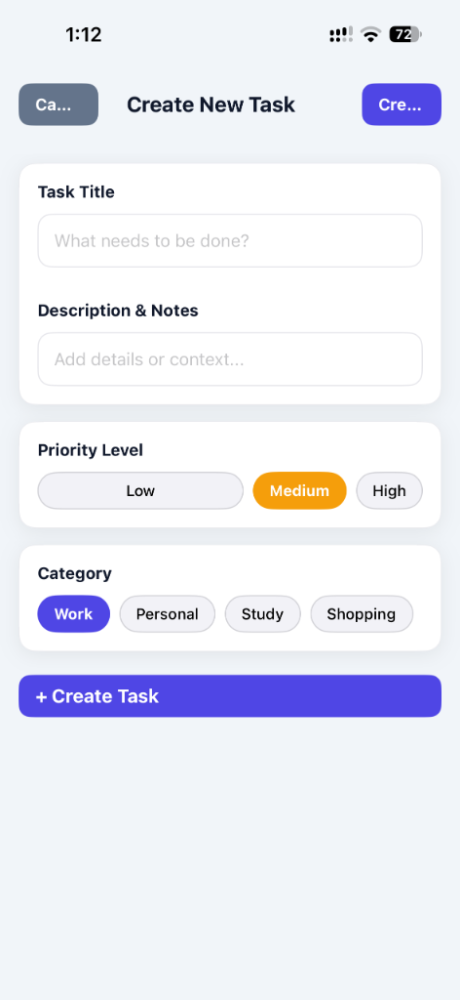
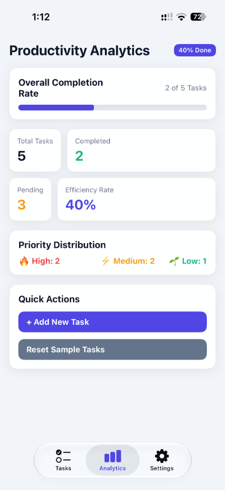
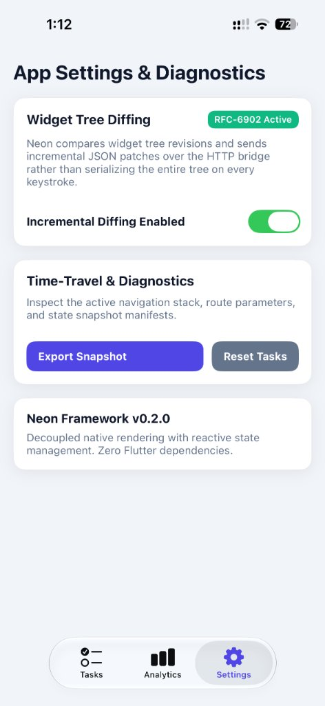

# Neon Framework ⚡

> **A modern, high-performance, standalone Dart UI framework for Android & iOS — built completely independent of Flutter.**

<p align="center">
  
</p>

<p align="center">
  <a href="https://neonframework.dev"></a>
  <a href="https://docs.neonframework.dev/docs/quick-start"></a>
  <a href="https://dart.dev"></a>
  <a href="https://developer.android.com"></a>
  
  <a href="LICENSE"></a>
  
</p>

<p align="center">
  🌐 <a href="https://neonframework.dev"><strong>neonframework.dev</strong></a> &nbsp;&bull;&nbsp; 
  📚 <a href="https://docs.neonframework.dev/docs/quick-start"><strong>Official Documentation & Quick Start</strong></a>
</p>

---

## 📖 Table of Contents

- [Overview](#-overview)
- [Architectural Advantage: Why Neon Outperforms](#-architectural-advantage-why-neon-outperforms-traditional-frameworks)
- [Neon vs. Flutter Comparison](#-neon-vs-flutter-at-a-glance-comparison)
- [Featured Demo: Neon Task Studio App](#-featured-demo-neon-task-studio-app)
- [Key Features](#-key-features)
- [System Architecture](#-system-architecture)
- [Core Layers](#-core-layers)
  - [1. Core Runtime & Lifecycle](#1-core-runtime--lifecycle)
  - [2. Declarative Widget System & UI Catalog](#2-declarative-widget-system--ui-catalog)
  - [3. Widget Tree Diffing & Patch Engine](#3-widget-tree-diffing--patch-engine)
  - [4. Declarative Navigation & Deep Linking](#4-declarative-navigation--deep-linking)
  - [5. Rendering Pipeline & Layout Constraints](#5-rendering-pipeline--layout-constraints)
  - [6. Reactive State Management (Signals)](#6-reactive-state-management-signals)
  - [7. Platform Bridge & Native Shells](#7-platform-bridge--native-shells)
  - [8. Data Layer (Storage, SQLite, Networking)](#8-data-layer-storage-sqlite-networking)
  - [9. Extensibility & Plugin Architecture](#9-extensibility--plugin-architecture)
  - [10. Developer CLI & Hot Reload Engine](#10-developer-cli--hot-reload-engine)
  - [11. Flutter-to-Neon AST Transpiler](#11-flutter-to-neon-ast-transpiler)
- [Project Directory Structure](#-project-directory-structure)
- [Quick Start Guide](#-quick-start-guide)
  - [Prerequisites](#prerequisites)
  - [1. Start Dart Backend](#1-start-the-dart-backend)
  - [2. Run Android Shell](#2-run-on-android)
  - [3. Run iOS Shell](#3-run-on-ios)
  - [4. Web Preview & Inspection](#4-web-preview--inspection)
- [Testing](#-testing)
- [Contributing & Best Practices](#-contributing--best-practices)
- [Copyright & Ownership](#-copyright--ownership)
- [License](#-license)

---

## 🌟 Overview

**Neon Framework** is a custom, mobile-first Dart UI framework designed to author cross-platform mobile apps for Android and iOS without relying on Flutter or its C++ Skia/Impeller engine. 

Instead of drawing pixels to a canvas or embedding web views, Neon runs your business logic and widget trees in standard Dart, serializing the UI hierarchy to JSON. Native mobile shells (written in **Kotlin** for Android and **Swift** for iOS) fetch this tree, instantiate **100% true native platform views** (`android.widget.*` and UIKit `UIView`), and dispatch user events back to Dart over an HTTP bridge.

### Why Neon?

- **Zero Flutter Dependency**: Full ownership over the runtime, build pipeline, memory footprint, and toolchain.
- **Genuine Native UI & Accessibility**: Native platform views look, feel, and behave with authentic platform animations, accessibility features (TalkBack, VoiceOver), and OS-native text rendering.
- **High-Performance Tree Diffing**: In-place view property updates with up to **98% payload compression**, preserving native scroll positions, text field focus, and selection state.
- **Unified Reactive Paradigm**: Fine-grained reactive state using signals (`NeonSignal`, `NeonComputed`, `NeonEffect`) and asynchronous state containers (`NeonAsyncValue`).
- **Complete Application Stack**: Includes declarative routing, local SQLite with migrations, typed key-value storage, HTTP client with interceptors, WebSocket client, offline caching policies, and an extensible plugin system.
- **Flutter Migration Path**: An AST-based transpiler transforms existing Flutter widget code into idiomatic Neon code automatically.

---

## 🚀 Architectural Advantage: Why Neon Outperforms Traditional Frameworks

By eliminating heavy C++ canvas engines and fragile JS bridges, Neon delivers direct native fidelity with Dart developer speed.

<p align="center">
  
</p>

| Feature | Neon Framework <br><sup>⭐ **RECOMMENDED**</sup> | Flutter | React Native |
|---|---|---|---|
| **Engine Footprint** | ✅ **0 MB** (No embedded engine) | 15MB – 25MB (Skia/Impeller) | 8MB – 12MB (Hermes JS Engine) |
| **Render Target** | ✅ **100% Native Views** (Kotlin & UIKit) | Canvas Emulation (Skia pixels) | Native Views via Async Bridge |
| **Hot Reload Latency** | ✅ **< 100ms** (3-Tier Engine) | 200ms – 600ms | 300ms – 800ms (Fast Refresh) |
| **Logic Language** | ✅ **Dart 3** (Sound Null Safety) | Dart 3 | JavaScript / TypeScript |
| **Code Migration** | ✅ **Automated AST Transpiler** | Manual rewrite | Manual rewrite |
| **Platform Accessibility** | ✅ **100% Native OS Support** | Custom accessibility bridge | Native accessibility tree |

---

## ⚡ Neon vs. Flutter: At a Glance Comparison

<p align="center">
  
</p>

| Dimension | Neon Framework | Flutter |
|---|---|---|
| **Rendering Backend** | **Native UI Components** (Platform Views) | Canvas Painter (Impeller / Skia) |
| **View Lifecycle** | **Cached View Management** (No re-render on reopen) | Frequent widget tree rebuilds |
| **State Management** | **Embedded Natively in SDK** (Signals + AsyncValue) | Requires external packages (Riverpod, Bloc, Provider) |
| **Binary Size (APK/IPA)** | **Ultra-compact** (Zero engine bloat) | Larger base engine footprint |
| **Build & Run Time** | **Rapid Compilation & Deploy** | Slower initial and clean builds |
| **Component Architecture** | **Lightweight Custom SDK** | Heavy Material / Cupertino layer abstractions |

---

## 📱 Featured Demo: Neon Task Studio App

> **Live Reference Repository**: [`https://github.com/hamze-ibraheem/neon_to_do_list_app.git`](https://github.com/hamze-ibraheem/neon_to_do_list_app.git)

**Neon Task Studio** is a complete, production-grade productivity application built entirely with **Neon Framework v0.2.0**. It serves as a real-world reference implementation demonstrating pure Dart reactive state management, high-frequency JSON tree diffing, and 100% native view rendering on mobile devices with zero Flutter dependencies.

<p align="center">
  
  &nbsp;
  
  &nbsp;
  
  &nbsp;
  
</p>

### What This Demo Showcases

1. **Task Management & Quick Actions** (Screen 1):
   - Dynamic **Progress Overview** bar calculating completion percentages in real time.
   - Category filtering with responsive chips (**Work**, **Personal**, **Study**, **Shopping**).
   - Fast inline task creation with priority levels (**High**, **Medium**, **Low**).
   - Interactive task cards with custom checkboxes, category tags, priority indicators, and edit/delete actions.

2. **Modal Task Creation Dialog** (Screen 2):
   - Full input form featuring [`NeonTextField`](file:///Users/hamzaalsarsour/Untitled/neon_custom_mobile_framework/NeonFramework-2/neon_framework/lib/src/widgets/text_field.dart) for title and description notes.
   - Priority selection pills and category chip selection.
   - Form validation and smooth native modal dismissal.

3. **Productivity Analytics Dashboard** (Screen 3):
   - Metric summary cards: Total Tasks, Completed, Pending, and Efficiency Rate.
   - Priority distribution overview and quick reset/creation action triggers.

4. **App Settings & Engine Diagnostics** (Screen 4):
   - **RFC-6902 Widget Tree Diffing Engine**: Live switch toggle allowing developers to observe incremental JSON patching vs. full tree rebuilds in real-time.
   - **Time-Travel & Diagnostics**: Inspect active navigation stacks, route parameters, and state snapshot manifests.
   - **Decoupled Architecture**: 100% native UI rendering driven by a headless Dart backend.

### Running the Demo App

```bash
# Clone the demo app repository
git clone https://github.com/hamze-ibraheem/neon_to_do_list_app.git
cd neon_to_do_list_app

# Fetch dependencies and run
dart pub get
dart run lib/main.dart
```

---

## ✨ Key Features

| Capability | Neon Implementation |
|---|---|
| **Language & Engine** | Pure Dart 3 (No Flutter engine, no Skia/Impeller required) |
| **Native Views** | Android (Kotlin / standard Android SDK) & iOS (Swift / UIKit) |
| **Bridge Protocol** | HTTP JSON Bridge (`/api/tree`, `/action`, `/remote-demo`) with live web inspector |
| **Incremental Updates** | High-speed structural tree diffing with atomic patch operations (`update`, `replace`, `insert`, `remove`) |
| **Component Suite** | 40+ Material 3 widgets: Buttons, SegmentedButtons, TextFields, Sliders, Chips, Badges, Cards, Dialogs, BottomSheets, Lists, Slivers, etc. |
| **Routing** | Declarative nested router with URL parameters, wildcards, guards, history controllers, and telemetry |
| **State Management** | Signals-first reactive architecture + `setState()` with automatic microtask queue synchronization |
| **Data & Storage** | Typed Key-Value Store, SQLite database with versioned migrations, REST HTTP Client with interceptors, WebSocket client with auto-reconnect |
| **Tooling** | Custom CLI (`neon create`, `neon run`, `neon build`, `neon doctor`, `neon clean`) and 3-tier Hot Reload engine |
| **AST Transpiler** | Flutter-to-Neon source-to-source code converter for instant component migration |

---

## 🏗️ System Architecture

The following diagram illustrates the complete execution flow of Neon Framework:

```
┌────────────────────────────────────────────────────────────────────────┐
│                        Neon Dart Backend                               │
│                                                                        │
│   ┌─────────────────────┐             ┌────────────────────────────┐   │
│   │   Widget Tree       │             │   Reactive Signals         │   │
│   │   Stateless/Stateful│◄────────────┤   NeonSignal / Computed    │   │
│   └──────────┬──────────┘  rebuild    └────────────────────────────┘   │
│              │                                                         │
│              ▼                                                         │
│   ┌─────────────────────┐             ┌────────────────────────────┐   │
│   │  JSON Serialization │             │  Widget Tree Diff Engine   │   │
│   │  Tree Snapshot (vN) ├────────────►│  Delta: Atomic Patches     │   │
│   └──────────┬──────────┘             └─────────────┬──────────────┘   │
│              │                                      │                  │
│              │ Full Tree (v1 / recovery)            │ Patch (v2..N)    │
│              └──────────────────┬───────────────────┘                  │
│                                 ▼                                      │
│               ┌───────────────────────────────────┐                    │
│               │   Neon HTTP UI Server (:8080)     │                    │
│               │   GET /api/tree  |  POST /action  │                    │
│               └─────────────────▲─────────────────┘                    │
└─────────────────────────────────┼──────────────────────────────────────┘
                                  │  Local Network / adb reverse / HTTP
                                  │
      ┌───────────────────────────┴───────────────────────────┐
      │                                                       │
      ▼                                                       ▼
┌──────────────────────────────┐        ┌──────────────────────────────┐
│     Android Native Shell     │        │      iOS Native Shell        │
│      (Kotlin / Android)      │        │        (Swift / UIKit)       │
│                              │        │                              │
│  - MainActivity.kt           │        │  - ViewController.swift      │
│  - ViewRegistry & PatchApplier│       │  - ViewRegistry & PatchApplier│
│  - 100% Native Views:        │        │  - 100% Native Views:        │
│    TextView, LinearLayout,   │        │    UILabel, UIStackView,     │
│    Switch, SeekBar, etc.     │        │    UISwitch, UISlider, etc.  │
│  - User Touch Dispatches:    │        │  - User Touch Dispatches:    │
│    POST /action {id, value}  │        │    POST /action {id, value}  │
└──────────────────────────────┘        └──────────────────────────────┘
```

---

## 🧩 Core Layers

### 1. Core Runtime & Lifecycle

Located in [`neon_framework/lib/src/core/`](file:///Users/hamzaalsarsour/Untitled/neon_custom_mobile_framework/NeonFramework-2/neon_framework/lib/src/core/):

- **`NeonApp.run(NeonWidget root, {NeonConfig config})`**: The application entry point. Builds the widget tree, spins up the HTTP UI bridge, mounts the global state store, and prints console render frames.
- **`NeonLifecycleManager`**: Observes application state transitions (`onInit`, `onPause`, `onResume`, `onDispose`, `onHotReload`).
- **`NeonConfig` & `NeonEnvironment`**: Supports `development`, `staging`, and `production` configurations, custom port assignments, diffing flags, and build flavors.
- **`NeonErrorHandler`**: Environment-aware error handling boundaries (throws descriptive errors in development; recovers, isolates, and logs in production).

---

### 2. Declarative Widget System & UI Catalog

Located in [`neon_framework/lib/src/widgets/`](file:///Users/hamzaalsarsour/Untitled/neon_custom_mobile_framework/NeonFramework-2/neon_framework/lib/src/widgets/):

Neon follows a composition-based widget paradigm modeled after Flutter, but built on lightweight, serializable elements:

#### Base Classes
- **`NeonWidget`**: Immutable configuration node with optional string `key`.
- **`StatelessWidget`**: Pure build function (`NeonWidget build(NeonBuildContext context)`).
- **`StatefulWidget` & `NeonState<T>`**: Stateful component with `setState()`, `initState()`, and `dispose()`.
- **`NeonElement` & `NeonWidgetTree`**: Retained hierarchy managing element mounting, updates, tree traversal, and JSON serialization.

#### Layout Primitives
- `Container`: Complete box model (width, height, padding, margin, decoration, border radius, background color).
- `Column` / `Row`: Flex layouts with `MainAxisAlignment`, `CrossAxisAlignment`, and `MainAxisSize`.
- `Stack` / `Positioned`: Z-axis stacking with absolute coordinate positioning.
- `Padding`, `Center`, `SizedBox`, `Expanded`, `Spacer`.

#### Material 3 & Modern Component Suite
- **Buttons**: `Button`, `FilledButton`, `ElevatedButton`, `TextButton`, `OutlinedButton`, `IconButton`, `FloatingActionButton`, `SegmentedButton`.
- **Form Inputs & Selection**:
  - `NeonTextField`: Text input with placeholder, onChanged, onSubmitted, keyboard types, and value synchronization.
  - `NeonSearchBar` & `SearchAnchor`: Search field with search callbacks, submission, and toggle behavior.
  - `Switch`: Native toggle with boolean callback.
  - `Checkbox`: Three-state support and checked listeners.
  - `Radio`: Radio selection with generic value matching and `selectValue()` routing.
  - `Slider` & `RangeSlider`: Continuous and discrete range value selectors.
- **Chips**: `Chip`, `ActionChip`, `FilterChip`, `InputChip`, `ChoiceChip`.
- **Badges & Progress**: `Badge`, `LinearProgressIndicator`, `CircularProgressIndicator`, `Tooltip`.
- **Surfaces & Overlays**: `Card`, `Dialog` / `AlertDialog`, `BottomSheet`, `ListTile`, `SnackBar`.
- **Navigation Components**: `AppBar`, `NavigationBar`, `NavigationDestination`, `NavigationDrawer`, `NavigationRail`, `TabBar`, `MenuAnchor`, `NeonMenuBar`.
- **Scroll Views & Slivers**: `SingleChildScrollView`, `ListView` (`ListView.builder`, `ListView.separated`), `CustomScrollView`, `SliverList`, `SliverAppBar`.
- **Server-Driven UI**: `RemoteWidget` for dynamically loading UI nodes from remote URLs.

---

### 3. Widget Tree Diffing & Patch Engine

Located in [`neon_framework/lib/src/widgets/tree_diff.dart`](file:///Users/hamzaalsarsour/Untitled/neon_custom_mobile_framework/NeonFramework-2/neon_framework/lib/src/widgets/tree_diff.dart):

Instead of serializing the entire widget tree on every user interaction, Neon's diff engine calculates the structural difference between tree revisions.

#### How It Works
1. When the client makes a request (`POST /action`), it includes its current revision via header `X-Neon-Client-Revision` or payload `clientRevision`.
2. The Dart engine updates state, flushes the microtask queue (`await Future.delayed(Duration.zero)`), and rebuilds the tree.
3. If the base revision matches, `NeonWidgetTreeDiff.diff(oldTree, newTree)` generates atomic operations:
   - **`update`**: Updates specific view attributes in-place (e.g. `text`, `color`, `isChecked`, `progress`).
   - **`replace`**: Replaces a sub-branch of the tree when widget types differ.
   - **`insert`**: Inserts a new child into a parent view collection.
   - **`remove`**: Removes a removed child.
4. **Native View State Preservation**: Because views are updated in-place rather than reconstructed:
   - Soft keyboard stays open.
   - Input cursor and selection remain intact.
   - Scroll offsets in `ScrollView` or `ListView` are preserved.
5. **Fallback Recovery**: If a revision mismatch occurs, the engine automatically transmits a full tree (`type: "full"`) to re-synchronize the client cleanly.

---

### 4. Declarative Navigation & Deep Linking

Located in [`neon_framework/lib/src/navigation/`](file:///Users/hamzaalsarsour/Untitled/neon_custom_mobile_framework/NeonFramework-2/neon_framework/lib/src/navigation/):

- **`NeonRouter`**: Top-level router managing navigation history, listeners, and route matching.
- **`NeonRoute`**: Declarative route definitions supporting nesting, child routes, and transitions.
- **`NeonPathMatcher`**: Pattern matching engine supporting static paths (`/`), parameters (`/users/:userId`), query parameters (`?filter=active`), and wildcard catch-alls (`/files/*filePath`).
- **`NeonRouteGuard`**: Async navigation middleware for authentication, permission validation, and redirects.
- **`NavigatorController`**: Programmatic navigation (`push`, `pop`, `replace`, `goTo`, `canPop`).
- **Navigation Telemetry**: Real-time breadcrumbs tracking for debugging and analytics.

```dart
final router = NeonRouter(
  initialLocation: '/dashboard',
  routes: [
    NeonRoute(
      path: '/dashboard',
      builder: (context, state) => const DashboardScreen(),
      children: [
        NeonRoute(
          path: 'details/:id',
          builder: (context, state) => DetailScreen(id: state.param('id')),
        ),
      ],
    ),
  ],
);
```

---

### 5. Rendering Pipeline & Layout Constraints

Located in [`neon_framework/lib/src/rendering/`](file:///Users/hamzaalsarsour/Untitled/neon_custom_mobile_framework/NeonFramework-2/neon_framework/lib/src/rendering/):

Neon incorporates a Flutter-style constraints-based layout system:
- **Constraints In / Size Out**: Parents pass down `NeonConstraints` (minWidth, maxWidth, minHeight, maxHeight), and children determine their own `NeonSize`.
- **Render Objects**: `NeonRenderObject`, `RenderText`, `RenderContainer`, `RenderColumn`, `RenderRow`, `RenderStack`.
- **Render Pipeline**: Three sequential phases:
  1. **Layout**: Propagates constraints and computes geometry.
  2. **Paint**: Emits display list commands via `NeonCanvas` (`drawRect`, `drawText`, `drawCircle`, `drawLine`).
  3. **Composite**: Assembles render layers for output.
- **Animation Foundations**: `NeonAnimationValue` with easing curves (`linear`, `easeIn`, `easeOut`, `easeInOut`) and spring physics simulations.

---

### 6. Reactive State Management (Signals)

Located in [`neon_framework/lib/src/state/`](file:///Users/hamzaalsarsour/Untitled/neon_custom_mobile_framework/NeonFramework-2/neon_framework/lib/src/state/):

Neon offers fine-grained reactivity inspired by SolidJS and Preact Signals:

- **`NeonSignal<T>`**: Holds a reactive value and notifies observers only when the value changes.
- **`NeonComputed<T>`**: Derived state that automatically tracks its dependent signals and lazily recomputes.
- **`NeonEffect`**: Side effect runner that executes on dependency changes.
- **`NeonAsyncValue<T>`**: Safe async state handler supporting loading, data, error, and cached states with pattern matching (`when()` / `maybeWhen()`).
- **`SignalMixin`**: Integrates signals into `NeonState`, automatically scheduling rebuilds when any watched signal mutates.
- **`NeonSignalProvider`**: Scopes and injects signals down the widget tree using inherited context lookup.

```dart
// Reactive Signal
final counter = NeonSignal<int>(0);

// Derived Computed Value
final doubleCounter = NeonComputed<int>(() => counter.value * 2);

// Auto-triggering Effect
NeonEffect(() {
  print('Count updated: ${counter.value}, doubled: ${doubleCounter.value}');
});

// Update value
counter.value++;
```

---

### 7. Platform Bridge & Native Shells

Located in [`neon_framework/lib/src/platform/`](file:///Users/hamzaalsarsour/Untitled/neon_custom_mobile_framework/NeonFramework-2/neon_framework/lib/src/platform/) and [`my_2nd_test_app/`](file:///Users/hamzaalsarsour/Untitled/neon_custom_mobile_framework/NeonFramework-2/neon_framework/my_2nd_test_app/):

The platform bridge connects Dart's headless logic to true mobile views:

1. **Dart HTTP Bridge**: Neon starts an embedded HTTP server (defaults to `0.0.0.0:8080`):
   - `GET /api/tree`: Returns the current widget tree JSON.
   - `POST /action`: Accepts user actions (`{id, value, index, clientRevision}`), dispatches callbacks, and returns diff patches.
   - `GET /`: Serves an interactive HTML/JS Web Preview for immediate browser testing.
2. **Android Shell (`MainActivity.kt`)**:
   - Written in Kotlin with Gradle.
   - Recursively inflates native Android views (`android.widget.TextView`, `android.widget.Button`, `android.widget.Switch`, `android.widget.CheckBox`, `android.widget.SeekBar`, etc.).
   - Implements `applyPatch(JSONObject)` to alter properties directly on native view instances using a view cache.
3. **iOS Shell (`ViewController.swift`)**:
   - Written in Swift targeting UIKit.
   - Maps JSON nodes to `UILabel`, `UIButton`, `UISwitch`, `UISlider`, `UIStackView`, etc.
   - Implements `applyPatch(json)` for surgical in-place UIKit tree updates.
4. **Platform Abstractions**:
   - `NeonPlatformChannel`: Bidirectional message passing between Dart and native code.
   - `NeonPlatformInfo`: Screen dimensions, pixel ratio, safe area insets, and dark mode detection.
   - `NeonFileSystem`: Sandboxed directory paths (`appDocuments`, `appCache`, `appSupport`, `temp`).
   - `NeonPlatformLifecycle`: Bridges native lifecycle states into Dart.

---

### 8. Data Layer (Storage, SQLite, Networking)

Located in [`neon_framework/lib/src/data/`](file:///Users/hamzaalsarsour/Untitled/neon_custom_mobile_framework/NeonFramework-2/neon_framework/lib/src/data/):

Neon provides production-grade data storage and communication without external dependencies:

- **`NeonKeyValueStore`**: Type-safe preferences store (`getString`, `setInt`, `setDouble`, `setBool`, `setJson`) with prefix namespaces and in-memory test backends.
- **`NeonDatabase`**: Structured SQLite persistence with typed schemas (`NeonTableSchema`, `NeonColumn`), constraint definitions, versioned migrations (`NeonMigration`), and a fluent query builder.
- **`NeonHttpClient`**: Full-featured HTTP client (GET, POST, PUT, PATCH, DELETE, HEAD) supporting base URLs, configurable timeouts, request/response interceptors, and mock backends.
- **`NeonWebSocket`**: Real-time client with automatic reconnection, exponential backoff, JSON serialization, and connection lifecycle callbacks.
- **`NeonCachePolicy`**: 5 offline-first caching policies:
  - `cacheFirst`: Read from local cache, fall back to network.
  - `networkFirst`: Read from network, fall back to cache when offline.
  - `cacheOnly`: Strict offline execution.
  - `networkOnly`: Always bypass cache.
  - `staleWhileRevalidate`: Return cached data instantly while refreshing in the background.

---

### 9. Extensibility & Plugin Architecture

Located in [`neon_framework/lib/src/plugins/`](file:///Users/hamzaalsarsour/Untitled/neon_custom_mobile_framework/NeonFramework-2/neon_framework/lib/src/plugins/):

A dual-mode plugin architecture:
- **`NeonDartPlugin`**: Pure Dart plugins with lifecycle hooks (`onRegister`, `onDispose`).
- **`NeonNativePlugin`**: Plugins requiring native platform bridges; automatically creates and registers platform channels.
- **`NeonPluginRegistry`**:
  - Full Semantic Versioning (`NeonSemanticVersion`) parsing and checking.
  - SDK compatibility constraints (`NeonSdkConstraint`).
  - Topological dependency graph resolution.
  - Capability conflict detection.
  - Named hook dispatcher for loose coupling.
- **Bundled Plugins**:
  - `NeonLoggerPlugin`: 5-level structured logger with tag filtering.
  - `NeonDeviceInfoPlugin`: Platform info and battery level bridge.

---

### 10. Developer CLI & Hot Reload Engine

Located in [`neon_framework/bin/neon.dart`](file:///Users/hamzaalsarsour/Untitled/neon_custom_mobile_framework/NeonFramework-2/neon_framework/bin/neon.dart) and [`neon_framework/tool/tooling/`](file:///Users/hamzaalsarsour/Untitled/neon_custom_mobile_framework/NeonFramework-2/neon_framework/tool/tooling/):

The `neon` command-line tool coordinates project authoring, execution, and builds:

| Command | Description |
|---|---|
| `neon create <app_name>` | Scaffolds a new project (`--template app` or `--template minimal`) |
| `neon run` | Launches the app with file watching and the hot reload engine |
| `neon build` | Compiles production artifacts (`--platform android` or `--platform ios`) |
| `neon doctor` | Diagnoses developer environment (Dart SDK, Android Studio, Xcode, Java, CocoaPods) |
| `neon clean` | Wipes build caches and generated artifacts |

#### Three-Tier Hot Reload
- **Tier 1 (UI-Only)**: Re-runs the build methods on existing widgets without resetting state.
- **Tier 2 (State-Preserving)**: Preserves global signals and state store values while swapping widget implementations.
- **Tier 3 (Full Restart)**: Resets state store and rebuilds the application from scratch if structural signatures changed.

---

### 11. Flutter-to-Neon AST Transpiler

Located in [`tools/transpiler/`](file:///Users/hamzaalsarsour/Untitled/neon_custom_mobile_framework/tools/transpiler/):

A source-to-source converter using `package:analyzer` that automatically translates Flutter code to Neon code:

- Converts imports (`package:flutter/material.dart` → `package:neon_framework/neon.dart`).
- Maps Flutter widgets to Neon widgets (`ElevatedButton` → `FilledButton`, `TextField` → `NeonTextField`, `TextStyle` → `NeonTextStyle`, etc.).
- Converts `StatelessWidget` / `StatefulWidget` / `State<T>` to Neon equivalents.
- Preserves business logic, callbacks, and parameters.
- Generates a barrel export at `lib/neon_compat/neon_compat.dart`.

```bash
# Run the transpiler
dart run tools/transpiler/main.dart flutter_input/ lib/neon_compat/
```

---

## 📁 Project Directory Structure

```
neon_custom_mobile_framework/
├── README.md                              # This documentation
├── pubspec.yaml                           # Root deployment wrapper
├── replit.md                              # Project notes and architecture
├── Dockerfile                             # Containerization definition
│
├── tools/
│   └── transpiler/
│       ├── main.dart                      # Flutter-to-Neon AST transpiler
│       └── widget_mapping.dart            # Flutter-to-Neon 50+ widget & enum map
│
├── lib/
│   └── neon_compat/
│       └── neon_compat.dart               # Transpiled components export
│
└── NeonFramework-2/
    ├── main.dart                          # Standalone entrypoint
    ├── pubspec.yaml                       # Root workspace configuration
    └── neon_framework/                    # Core Framework SDK package
        ├── pubspec.yaml                   # Neon Framework package manifest
        ├── README.md                      # Package documentation
        ├── bin/
        │   └── neon.dart                  # Neon CLI executable
        ├── lib/
        │   ├── neon.dart                  # Public barrel export
        │   └── src/
        │       ├── core/                  # NeonApp, lifecycle, error handlers
        │       ├── widgets/               # Widget system, M3 widgets, tree diff
        │       ├── navigation/            # Declarative router, matcher, guards
        │       ├── rendering/             # Constraints, canvas, render objects
        │       ├── state/                 # Signals, computed, effects, async values
        │       ├── platform/              # Platform channels, bridge, filesystem
        │       ├── data/                  # KV store, SQLite, HTTP, WebSocket, cache
        │       └── plugins/               # Plugin model, registry, semver, hooks
        ├── test/                          # Comprehensive test suite (403 tests)
        │   ├── core_test.dart
        │   ├── widgets_test.dart
        │   ├── m3_widgets_test.dart
        │   ├── navigation_test.dart
        │   ├── tree_diff_test.dart
        │   ├── native_action_test.dart
        │   └── json_fix_test.dart
        ├── tool/                          # Tooling & CLI commands implementation
        │   ├── benchmark_diff.dart
        │   └── tooling/                   # neon create, run, build, doctor, clean
        └── my_2nd_test_app/               # Reference showcase application
            ├── pubspec.yaml
            ├── neon.yaml
            ├── lib/
            │   ├── main.dart              # Dart server entrypoint
            │   └── screens/               # 8 Showcase screens (Dashboard, Inputs, etc.)
            ├── android/                   # Native Android Studio project
            │   └── app/src/main/kotlin/com/neon/myapp/MainActivity.kt
            └── NeonApp/                   # Native iOS Xcode project
                └── NeonApp/ViewController.swift
```

---

## 🚀 Quick Start Guide

> 📖 **Official Documentation**: Detailed step-by-step guides and API references are available at **[docs.neonframework.dev/docs/quick-start](https://docs.neonframework.dev/docs/quick-start)**. Explore tutorials, showcase projects, and updates on **[neonframework.dev](https://neonframework.dev)**.

### Prerequisites

- **Dart SDK**: `^3.0.0`
- **Android Studio** (for Android): Android SDK API 34, Java 17
- **Xcode 15+** (for iOS, on macOS)

---

### 1. Start the Dart Backend

The Dart backend serves the widget tree and processes UI actions. Navigate to the test app and launch it:

```bash
cd NeonFramework-2/neon_framework/my_2nd_test_app
dart pub get
dart run lib/main.dart
```

You should see:
```text
╔══════════════════════════════════════╗
║         Neon Framework v0.1.0        ║
║     Mobile-first · Dart-powered      ║
╚══════════════════════════════════════╝
  Environment : development
  Root Widget : ShowcaseApp
  Status      : Running

📡 Neon UI Server running on http://0.0.0.0:8080
```

Keep this terminal process running.

---

### 2. Run on Android

1. Connect your Android device or start an Android Emulator.
2. Forward the local port so the emulator or physical device can reach your computer's Dart server:
   ```bash
   adb reverse tcp:8080 tcp:8080
   ```
3. Open `NeonFramework-2/neon_framework/my_2nd_test_app/android` in **Android Studio**.
4. Click **Run** (`Shift + F10`) or execute:
   ```bash
   cd NeonFramework-2/neon_framework/my_2nd_test_app/android
   ./gradlew installDebug
   ```

---

### 3. Run on iOS

1. Open `NeonFramework-2/neon_framework/my_2nd_test_app/NeonApp/NeonApp.xcodeproj` in **Xcode**.
2. Select an iOS Simulator (e.g., iPhone 15 / 16).
3. The iOS shell connects to `http://localhost:8080/api/tree`.
4. Click **Run** (`Cmd + R`) in Xcode.

---

### 4. Web Preview & Inspection

You can preview and test your Neon application in any web browser without needing a mobile device:

Open **`http://localhost:8080`** in Google Chrome or Safari to view the live interactive web renderer, trigger button clicks, toggle switches, and view realtime JSON payload updates.

---

## 🧪 Testing

Neon Framework includes a rigorous test suite covering the entire stack, including widget lifecycle, state reactivity, tree diffing, native action routing, and error recovery:

```bash
cd NeonFramework-2/neon_framework
dart test
```

**Results:**
```text
00:01 +403: All tests passed!
```

---

## 💡 Code Example: A Complete Neon Screen

```dart
import 'package:neon_framework/neon.dart';

class CounterScreen extends StatefulWidget {
  const CounterScreen({super.key});

  @override
  NeonState<CounterScreen> createState() => _CounterScreenState();
}

class _CounterScreenState extends NeonState<CounterScreen> {
  int _count = 0;
  bool _notificationsEnabled = true;

  @override
  NeonWidget build(NeonBuildContext context) {
    return Container(
      padding: const NeonEdgeInsets.all(24),
      color: NeonColors.white,
      child: Column(
        mainAxisAlignment: MainAxisAlignment.center,
        crossAxisAlignment: CrossAxisAlignment.center,
        children: [
          Text(
            'Current Count: $_count',
            style: const NeonTextStyle(
              fontSize: 24,
              fontWeight: NeonFontWeight.bold,
              color: NeonColors.indigo,
            ),
          ),
          const SizedBox(height: 16),
          FilledButton(
            key: 'btn_increment',
            onPressed: () {
              setState(() {
                _count++;
              });
            },
            child: const Text('Increment'),
          ),
          const SizedBox(height: 24),
          Row(
            mainAxisAlignment: MainAxisAlignment.spaceBetween,
            children: [
              const Text('Enable Alerts'),
              Switch(
                key: 'sw_alerts',
                value: _notificationsEnabled,
                onChanged: (val) {
                  setState(() {
                    _notificationsEnabled = val;
                  });
                },
              ),
            ],
          ),
        ],
      ),
    );
  }
}
```

---

## 🤝 Contributing & Best Practices

1. **Keys on Interactive Widgets**: Always assign stable `key` identifiers (e.g. `key: 'btn_submit'`) to interactive components so the native shell can route action events accurately.
2. **Double Invariants**: When setting container dimensions, use standard finite numbers. Do not serialize raw `double.infinity` into JSON nodes.
3. **Async State Scheduling**: `setState()` operations run on the microtask queue; action handlers automatically await microtask synchronization before serializing updates.
4. **No Flutter Imports**: The framework is 100% standalone. Keep `package:flutter` dependencies out of framework source files.

---

## ⚖️ Copyright & Ownership

**Neon Framework** is authored, owned, and copyrighted by **Task Foundation LLC**, founded by **Hamza Ibrahim**.

| Attribute | Details |
|---|---|
| **Company** | **Task Foundation LLC** |
| **Founder** | **Hamza Ibrahim** |
| **Official Website** | [https://taskfoundation.net](https://taskfoundation.net) |
| **Company Profile & About** | [https://taskfoundation.net/about-us/](https://taskfoundation.net/about-us/) |
| **Corporate Address** | 30 N Gould St, Ste R, Sheridan, WY 82801, United States |
| **Contact Email** | [hamzaalsarsour@taskfoundation.net](mailto:hamzaalsarsour@taskfoundation.net) |
| **Core Expertise** | Advanced mobile frameworks, cross-platform & native mobile engineering (Android & iOS), scalable SaaS platforms, and enterprise digital solutions. |

---

## 📄 License

Copyright &copy; 2026 **Task Foundation LLC**. Founder: **Hamza Ibrahim**.

Neon Framework is open-source software licensed under the [MIT License](LICENSE).
